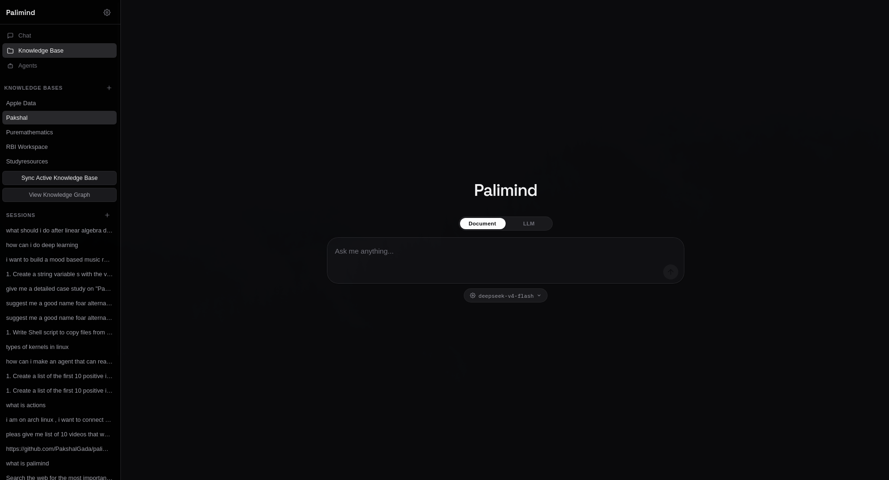
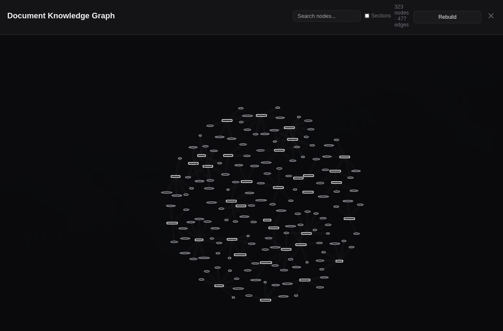
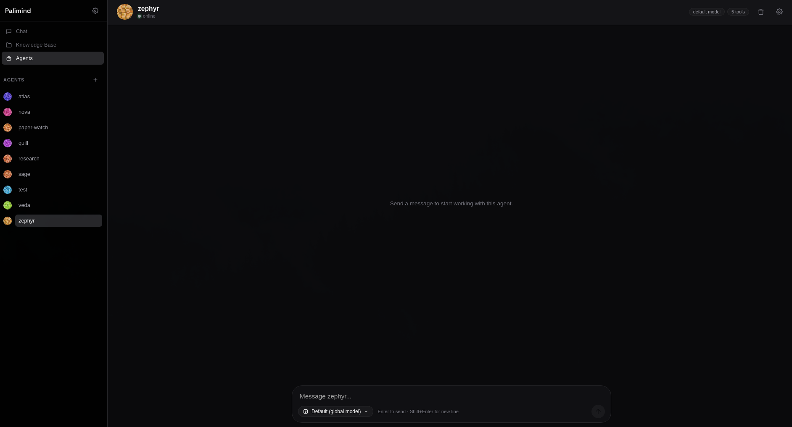

# PaliMind

PaliMind is an open-source, **local-first AI intelligence platform** that brings a full suite of AI productivity tools to your desktop. Local models run on your own machine via **Ollama**; no cloud subscription or external API key is required for local-only use.

PaliMind is local-first, not network-isolated: web search, URL fetching, optional MQTT/browser tools, and the optional OpenCode cloud provider send data to third parties when you use them. No telemetry is sent, and nothing leaves the machine unless you explicitly invoke one of those features.

---

## Table of Contents

- [Features](#features)
- [Architecture](#architecture)
- [Prerequisites](#prerequisites)
- [Installation](#installation)
- [Pulling Models](#pulling-models)
- [CLI Usage](#cli-usage)
- [Configuration](#configuration)
- [Tech Stack](#tech-stack)
- [Project Structure](#project-structure)
- [Contributing](#contributing)

---

## Features

### PaliSpace - RAG Workspace

The core retrieval-augmented generation (RAG) engine. Point it at any folder and index every document into a local vector store you can query in natural language.

- **Multimodal indexing** - parses PDF, DOCX, PPTX, XLSX, Markdown, code, CSV, and video (with Whisper transcription). Image OCR requires the optional `easyocr` dependency; without it images are skipped with an error rather than silently indexed.
- **Local vector store** - FAISS HNSW vectors with SQLite/FTS5 metadata for document chunks; a separate TurboVec index stores episodic chat memory. No external database server.
- **Hierarchical memory** - episodic conversation turns are embedded and retrieved for long-term context.
- **Session management** - multiple persistent chat sessions per workspace with summaries.
- **Web search** - integrated DuckDuckGo search and Scrapling for real-time context augmentation.
- **Knowledge graph** - entities and relationships extracted from documents, queryable and visualized.
- **Summarisation** - per-file summaries, financial fact extraction, and timeline extraction at index time.





### PalIAgents - Agent System

A runtime for creating and running specialized agents that can call tools to complete tasks. Agents can be created, run manually, invoked from chat with `@mention` syntax, and also can be scheduled.

Available tools include:

- **Shell execution** (`run_shell`)
- **Python execution** (`run_python`)
- **Web browsing** (`browse_url`)
- **Web search** (DuckDuckGo)
- **arxiv search**
- **RSS feed fetching**
- **CSV query**
- **SQLite query**
- **Knowledge graph query**
- **MQTT** publish/subscribe

Agents maintain their own memory, run history, and chat logs. Tool calls are audited and debug-traced by default.

Phase 4 adds an intelligence & automation layer:

- **Adaptive reasoning** — per-agent effort levels (`minimal`…`max`) chosen by a complexity classifier, with auto-escalation when an agent gets stuck.
- **Multi-agent orchestration** — fan-out parallel agents with a shared blackboard, conflict resolution, synthesis, and an arena/tournament mode (max 8 agents).
- **Skills as slash commands** — reusable behaviour bundles in `~/.palimind/skills/` (JSON/YAML), invocable as `/commit`, `/review`, …, with composition and a bundled marketplace.
- **Planning mode** — plan-then-execute with user review/editing, plan templates, a flowchart view, and rollback of file mutations.
- **Goals & background tasks** — objectives with success criteria, `/loop 5m …` scheduling, a monitoring dashboard and completion notifications (50 tasks / 7 days).
- **Structured self-critique** — per-task-type verification checklists, confidence scoring, bounded auto-retry and human review of low-confidence results.



### OpenCode Integration

PaliMind stores an OpenCode API key entered once in **Settings** (owner-only
permissions, never logged) and reuses it for its provider proxy. Keys already
configured with the OpenCode CLI are detected automatically — OpenCode v2 keeps
them in its local SQLite database, which PaliMind reads read-only. The launcher
never prompts for credentials in the terminal; without a key, local Ollama
models continue to work.

---

## Architecture

```
Tauri Desktop App
    |  spawns & manages the FastAPI server, registers global hotkeys,
    |  opens the main WebView window
    v
FastAPI Server (127.0.0.1:8000)
    |  REST + SSE streaming endpoints
    v
Ollama (127.0.0.1:11434)
    |  chat / embed / vision inference
    v
Local resources: SQLite (FTS5), vector store, filesystem, tools
```

The Tauri shell spawns the Python backend as a child process, polls it until healthy, then loads the React frontend at `http://127.0.0.1:8000/ui` inside a WebView window.

---

## Prerequisites

| Requirement | Version | Notes |
|---|---|---|
| Python | 3.12+ | Core backend (`pyproject.toml` requires ≥3.12) |
| Node.js | 20+ | Frontend build + Tauri CLI |
| Rust | stable | Tauri 2 toolchain |
| Ollama | latest | Local LLM inference engine |
| Linux system libs | — | Tauri deps: `libwebkit2gtk-4.1-dev libgtk-3-dev libayatana-appindicator3-dev librsvg2-dev` |

---

## Installation

### 1. Install Ollama

```bash
curl -fsSL https://ollama.com/install.sh | sh
```

Windows: download from [ollama.com/download](https://ollama.com/download).

### 2. Clone and set up the Python backend

```bash
git clone <your-repo-url> palimind
cd palimind

python -m venv .venv
source .venv/bin/activate
# Windows: .venv\Scripts\activate

pip install -e "packages/backend[dev]"
# optional hotkey support:
pip install -e "packages/backend[hotkey]"
```

> **Fast path (Linux/macOS):** `./scripts/bootstrap.sh` runs the full setup —
> Python backend (editable + dev tools), frontend/root `npm install`s,
> pre-commit hooks, and model pulls — idempotently. Then just `make dev`.

### 3. Install Rust / Tauri prerequisites

Install Rust via [rustup](https://rustup.rs), then on Linux ensure the required system libraries for Tauri are present (see the [Tauri prerequisites](https://v2.tauri.app/start/prerequisites/), or let `scripts/bootstrap.sh` install them).

### 4. Install frontend and desktop dependencies

```bash
npm install                                   # root (Tauri CLI)
cd packages/frontend && npm install && cd ..  # React frontend
```

### 5. Build the frontend once

The desktop app loads the prebuilt frontend, so build it before launching:

```bash
cd packages/frontend && npm run build && cd ..
```

### 6. Pull required models

```bash
ollama pull nomic-embed-text
ollama pull gemma4:e2b
```

---

## Launching

The one-command launcher installs missing dependencies, starts Ollama, launches the API server, and opens the desktop app:

```bash
pm ui
```

Related flags:

```bash
pm ui --skip-install       # skip dependency install (frontend is built if dist is missing)
pm ui --keep-backend       # keep Ollama/API server running after the app closes
pm ui --port 8001          # use a custom backend port
```

You can also run the backend directly:

```bash
python -m palimind.api_server --host 127.0.0.1 --port 8000
# or: make backend
```

---

## CLI Usage

PaliMind ships a `pm` CLI built with Typer.

### Indexing

```bash
pm init /path/to/project    # initialize a workspace
pm add /path/to/project     # index or update files
```

### Asking questions

```bash
pm ask "What are the key findings in the Q3 report?" --path /path/to/project
```


---

## Configuration

Per-workspace settings live in `.palimind/config.json` (created in the directory where you run `pm init`). Key defaults:

| Key                    | Default                  | Purpose                          |
| ---------------------- | ------------------------ | -------------------------------- |
| `embed_model`          | `bge-m3`                 | Embedding model                  |
| `embed_dim`            | `1024`                   | Must match `embed_model`         |
| `chat_model`           | `gemma4:e2b`             | Chat model                       |
| `chunk_size`           | `1500`                   | Document chunk size              |
| `chunk_overlap`        | `200`                    | Chunk overlap                    |
| `summarise`            | `false`                  | Generate per-file summaries      |
| `retrieval_limit`      | `10`                     | Chunks returned per retrieval    |
| `context_token_budget` | `8000`                   | Max tokens in LLM context        |
| `num_ctx`              | `16384`                  | Ollama context window (must cover `context_token_budget` + prompt overhead) |
| `rerank`               | `false`                  | Cross-encoder reranking (CPU-heavy) |
| `rerank_opt_in`        | `false`                  | Must be `true` to enable `rerank`; `PALIMIND_RERANK=1` overrides |
| `query_rewrite`        | `true`                   | LLM query rewriting at retrieval |
| `ollama_base_url`      | `http://localhost:11434` | Ollama endpoint                  |
| `extensions`           | (many)                   | Indexed file extensions          |

Agent runtime behavior is configurable via environment variables, including:

| Variable | Default | Purpose |
|---|---|---|
| `PALIMIND_ENABLE_PALIAGENTS` | `true` | Master switch for agents |
| `PALIMIND_SHELL_EXEC_TIMEOUT` | `30` | Shell tool timeout (s) |
| `PALIMIND_PYTHON_EXEC_TIMEOUT` | `30` | Python tool timeout (s) |
| `PALIMIND_PYTHON_EXEC_MEMORY_MB` | `512` | Python tool memory cap |
| `PALIMIND_ALLOWED_PATHS` | (empty) | Extra paths file tools may access |
| `PALIMIND_AGENT_SCHEDULER_TICK` | `15` | Scheduler poll interval (s) |

Mixture-of-Experts tuning (all optional):

| Variable | Default | Purpose |
|---|---|---|
| `PALIMIND_MOE_NUM_CTX` | `8192` | Ollama `num_ctx` for MoE LLM calls |
| `PALIMIND_MOE_CONTEXT_BUDGET_TOKENS` | `6000` | Live agent-history budget; older tool exchanges are compacted |
| `PALIMIND_MOE_MAX_CONCURRENCY` | `0` | Max parallel agents (`0` = auto: Ollama/RAM-aware) |
| `PALIMIND_MOE_MAX_AGENT_ITERATIONS` | `12` | Hard ceiling on tool iterations per agent |
| `PALIMIND_MOE_VERIFY` | `true` | Post-synthesis critique + one refinement pass |
| `PALIMIND_LLM_RETRIES` | `2` | Bounded retries for transient LLM failures |

Phase 4 (agent intelligence & automation) tuning (all optional):

| Variable | Default | Purpose |
|---|---|---|
| `PALIMIND_ADAPTIVE_REASONING` | `true` | Dynamic reasoning-effort allocation |
| `PALIMIND_ADAPTIVE_ESCALATE_ON_STUCK` | `true` | Escalate effort when an agent gets stuck |
| `PALIMIND_REASONING_CLASSIFIER_MODEL` | (light model) | Model for the complexity classifier |
| `PALIMIND_ORCHESTRATOR_MAX_AGENTS` | `8` | Max fan-out agents per orchestration |
| `PALIMIND_ORCHESTRATOR_MAX_CONCURRENCY` | `0` | Max parallel orchestrated agents (`0` = auto) |
| `PALIMIND_ORCHESTRATOR_CONFLICT_RESOLUTION` | `true` | Resolve agent disagreements before synthesis |
| `PALIMIND_SKILLS_ENABLE_MARKETPLACE` | `true` | Allow installing skills from the bundled catalog |
| `PALIMIND_SKILL_MAX_INSTRUCTIONS` | `20000` | Max instruction length for a validated skill |
| `PALIMIND_PLANNING_MODE` | `off` | Default planning mode (`off`/`review`/`auto`) |
| `PALIMIND_PLAN_MAX_STEPS` | `30` | Hard ceiling on generated plan steps |
| `PALIMIND_GOALS_MAX_TASKS` | `50` | Max live background tasks |
| `PALIMIND_GOALS_MAX_DURATION_DAYS` | `7` | Max lifetime of a background task/loop |
| `PALIMIND_GOALS_TICK` | `15` | Background-task runner poll interval (s) |
| `PALIMIND_SELF_CRITIQUE_THRESHOLD` | `0.6` | Min confidence before a result is accepted |
| `PALIMIND_SELF_CRITIQUE_MAX_RETRIES` | `1` | Automatic retries on low confidence |

---

## Security & privacy

- **Local API authentication** — every `/api/*` request needs a per-install bearer token. It is generated on first run at `~/.palimind/api_token` (mode `0600`) and can be overridden with `PALIMIND_API_TOKEN`. The UI receives an HttpOnly same-origin cookie; scripts should send `Authorization: Bearer <token>` or `X-Palimind-Token`.
- **Loopback by default** — the API binds `127.0.0.1` and rejects non-loopback clients unless `PALIMIND_ALLOW_REMOTE=1`. The Docker Compose file publishes the port on loopback and requires `PALIMIND_API_TOKEN`.
- **Proxy authentication** — the OpenCode proxy (`:11435`) requires a separate per-install token (`~/.palimind/opencode_proxy_token` / `OPENCODE_PROXY_TOKEN`), so other local processes cannot spend your key.
- **Approval gate** — new and existing agents require human approval for risky tools (`write_file`, `search_replace`, `run_python`, `run_shell`, browser mutations) by default. Opt out explicitly per agent by setting `human_in_loop_threshold: 0` with `approval_explicit: true`.
- **Execution sandbox** — `run_shell` and `run_python` run under bubblewrap with no network and a read-only workspace unless the agent has write access. Without `bwrap` they fail closed; `PALIMIND_ALLOW_UNSANDBOXED_EXEC=1` is an explicit, unsafe opt-out.
- **At-rest encryption** — not provided. Session/index files rely on your OS account and filesystem permissions.

**Platform support:** the desktop shell builds on Linux, macOS and Windows. The agent execution sandbox currently uses Linux namespaces (`bwrap`); on other platforms agent shell/Python tools are disabled unless the unsafe opt-out above is set.

## Tech Stack

| Layer | Technology |
|---|---|
| Desktop shell | Tauri 2 (Rust), Tauri global shortcut plugin |
| Frontend | React, TypeScript, Vite |
| Backend | Python 3.12+, FastAPI, Uvicorn |
| CLI | Typer, Rich |
| AI / Inference | Ollama (Gemma, nomic-embed-text) |
| Embeddings | Ollama embeddings (default `bge-m3`), FAISS HNSW; TurboVec for chat memory |
| STT / TTS | Faster-Whisper, Kokoro-ONNX |
| OCR | EasyOCR (optional extra) |
| Database | SQLite with FTS5 + WAL |
| Encryption at rest | Not implemented — data is protected by OS filesystem permissions only |
| Sandboxing | bubblewrap (`bwrap`) on Linux; shell/Python tools fail closed elsewhere |

---

## Project Structure

```
.
├── packages/
│   ├── backend/            # Python FastAPI backend
│   │   └── palimind/
│   │       ├── agents/     # agent runtime, registry, scheduler, tools
│   │       ├── audio/      # speech-to-text, text-to-speech
│   │       ├── cli/        # Typer CLI (commands, UI)
│   │       ├── core/       # shared infra: embedder, reranker, web search
│   │       ├── document/   # document engine, graph, stream
│   │       ├── generative/ # summariser, responder
│   │       ├── hwfit/      # hardware fitting / recommendations
│   │       ├── ingestion/  # chunkers, parsers, OCR, crawler, video
│   │       ├── llm/        # streaming + mixture-of-expert orchestration
│   │       ├── memory/     # session persistence, hierarchical memory
│   │       ├── opencode/   # OpenCode CLI auth + model routing
│   │       ├── rag/        # index lifecycle, retrieval + generation
│   │       ├── storage/    # SQLite, vector store, chat store
│   │       ├── api_server.py  # FastAPI application (entry point)
│   │       ├── api.py      # public library facade
│   │       ├── config.py   # per-workspace configuration
│   │       ├── settings.py # env-overridable app settings
│   │       ├── opencode_proxy.py  # standalone OpenCode proxy (entry point)
│   │       └── ...
│   └── frontend/           # React + TypeScript + Vite UI
│       └── src/            # components, views
├── apps/
│   └── desktop/            # Tauri 2 Rust shell
├── scripts/                # helper scripts
├── tests/                  # Python tests
└── pyproject.toml          # Python package + CLI entry point
```

---

## Contributing

1. Fork the repository.
2. Create a feature branch: `git checkout -b feature/your-feature`.
3. Commit your changes: `git commit -m "feat: add feature"`. Pre-commit hooks
   (ruff fix+format, whitespace, gitleaks) run automatically on commit.
4. Push and open a pull request — CI re-runs the same gates on a clean runner.

Before opening a PR, verify locally:

```bash
make lint              # ruff (backend) + oxlint (frontend)
make check-imports     # no legacy import names
make test              # backend pytest + frontend build/lint
make typecheck         # mypy on gated modules
ruff format --check .  # backend formatting gate (run from packages/backend)
```

- Unit tests: `cd packages/backend && python -m pytest -m "not integration"`
  (the fast local suite). The full suite (`pytest`) needs a running
  backend/Ollama — mark such tests `@pytest.mark.integration`.
- Run the checks above locally before opening a PR. `v*` tags trigger desktop
  installer builds and a draft GitHub Release.

Note: Core backend changes should degrade gracefully when Ollama is not running.

---

PaliMind is an open-source project. Contributions are welcome.
